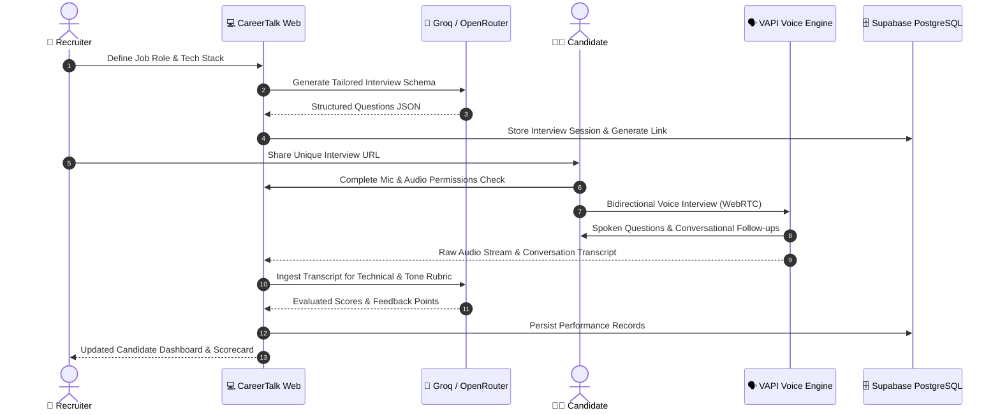

# 🎙️ CareerTalk AI — Voice-Based AI Interview Platform

<div align="center">


**An intelligent, low-latency voice-powered mock interview ecosystem designed to automate candidate screening, conduct realistic technical/behavioral drills, and generate instant rubric-based evaluations.**

[Explore Live Demo](https://career-talk.vercel.app) • [Architecture](SYSTEM_ARCHITECTURE.md) • [Report Bug](https://github.com/NischithGowdaR/career-talk/issues) • [Request Feature](https://github.com/NischithGowdaR/career-talk/issues)

</div>

---

## 🌟 Overview

**CareerTalk AI** bridges the gap between human interaction and automated recruitment workflows. Powered by **Next.js 15**, **VAPI WebRTC Voice AI**, **Groq / OpenRouter LLMs**, and **Supabase PostgreSQL**, the platform simulates authentic spoken interviews with bidirectional speech streaming, real-time voice activity detection, and comprehensive feedback scoring.

---

## 🧭 Multi-Role Architecture

The platform provides dedicated workflows tailored for three primary user personas:

### 👔 1. Recruiter Portal
- **AI-Driven Question Generation**: Enter job title, seniority, tech stack, and experience level to generate tailored behavioral and technical questions via Groq AI.
- **Candidate Performance Scorecards**: Access detailed rubrics (0–100 score), conversational transcripts, and technical accuracy evaluations.
- **Sharable Unique Links**: Generate secure, expiration-controlled interview links for candidates with one click.
- **Credit Billing**: Purchase interview creation credit packages seamlessly powered by Razorpay.

### 🧑‍💼 2. Candidate Voice Room
- **Low-Latency Spoken Dialogue**: Interactive voice conversations with AI Interviewer powered by VAPI over WebRTC (<400ms latency).
- **Audio Wave Visualizer & Proctoring**: Real-time microphone level checks, ambient noise calibration, and focus-locking anti-cheat alerts.
- **Targeted Practice Tracks**: 6 tailored industry tracks (Full-Stack Web, AI/ML, DevOps, Distributed Systems, Low-Latency Backend, and STAR Behavioral).
- **Post-Session Insights**: Instant performance breakdown and actionable recommendations for improvement.

### 🧑‍💻 3. Admin Operations Panel
- **Identity Verification Gate**: Secure passcode-protected admin access portal.
- **User Moderation**: Real-time monitoring of all user accounts with instantaneous ban/unban capabilities.
- **Credit & Interview Oversight**: Monitor platform-wide interview completions, credit balances, and database health.

---

## 🤖 End-to-End System Workflow



---

## 🧩 Tech Stack

| Domain | Technology | Purpose |
| :--- | :--- | :--- |
| **Framework** | **Next.js 15 (App Router)** | Full-stack architecture, SSR/SSG, and Serverless API Routes |
| **Frontend UI** | **React 18, Tailwind CSS 4** | Modern responsive interface, component tokens, Radix UI primitives |
| **Animations** | **Framer Motion & Lucide Icons** | Micro-interactions, audio visualizers, and polished design language |
| **Voice Engine** | **VAPI Voice AI (@vapi-ai/web)** | Real-time WebRTC audio streaming, Voice Activity Detection (VAD) |
| **Language Models**| **Groq AI (LLaMA 3) & OpenRouter** | Ultra-fast question synthesis and transcript evaluation |
| **Database & Auth**| **Supabase (PostgreSQL & GoTrue)** | User authentication, row-level security, interview storage |
| **Payments** | **Razorpay SDK** | Recruiter credit package purchases and webhook verification |
| **Video Infrastructure**| **Daily.co WebRTC** | Ephemeral interactive communication rooms |
| **Hosting** | **Vercel** | Serverless edge deployment, CI/CD pipeline |

---

## 🚀 Quickstart & Local Setup

### Prerequisites
- **Node.js**: `v18.18.0` or higher (Node 20+ LTS recommended)
- **npm** or **pnpm**
- A free **Supabase** account, **Groq API key**, and **VAPI account**

### 1. Clone the Repository
```bash
git clone https://github.com/NischithGowdaR/career-talk.git
cd career-talk
```

### 2. Install Dependencies
```bash
npm install
```

### 3. Setup Environment Variables
Create a `.env.local` file in the root directory:
```bash
cp .env.example .env.local
```
Fill in your configuration keys:
```env
NEXT_PUBLIC_SUPABASE_URL=https://your-project.supabase.co
NEXT_PUBLIC_SUPABASE_ANON_KEY=your-supabase-anon-key
GROQ_API_KEY=your-groq-api-key
OPENROUTER_API_KEY=your-openrouter-api-key
NEXT_PUBLIC_VAPI_API_KEY=your-vapi-public-key
DAILY_API_KEY=your-daily-co-api-key
NEXT_PUBLIC_ADMIN_EMAIL=careermock@admin.com
NEXT_PUBLIC_ADMIN_PASSWORD=your-admin-password
NEXT_PUBLIC_HOST_URL=http://localhost:3000
```

### 4. Run the Development Server
```bash
npm run dev
```
Open [http://localhost:3000](http://localhost:3000) in your browser.

---

## ☁️ Deployment

### Deploy to Vercel (Recommended)
1. Push your repository to GitHub.
2. Go to **[vercel.com](https://vercel.com)** ➔ **Add New Project** ➔ Import `career-talk`.
3. Add the environment variables listed above under **Project Settings ➔ Environment Variables**.
4. Click **Deploy**.
5. Update your **Supabase Dashboard** ➔ **Authentication** ➔ **URL Configuration** with your live Vercel domain (`https://your-app.vercel.app/**`) for authentication callbacks.

---

## 🧑‍💻 Author & Maintainer

**Nischith Gowda R**  
- 💼 LinkedIn: [Nischith Gowda R](https://linkedin.com)  
- 🐙 GitHub: [@NischithGowdaR](https://github.com/NischithGowdaR)  
- ✉️ Email: [nischitgowdar71@gmail.com](mailto:nischitgowdar71@gmail.com)  

---

## 📄 License & Contributing

Contributions, issues, and feature requests are welcome! Feel free to check the [issues page](https://github.com/NischithGowdaR/career-talk/issues).

⭐ *If you found this project helpful, please give it a star on GitHub!* ⭐

